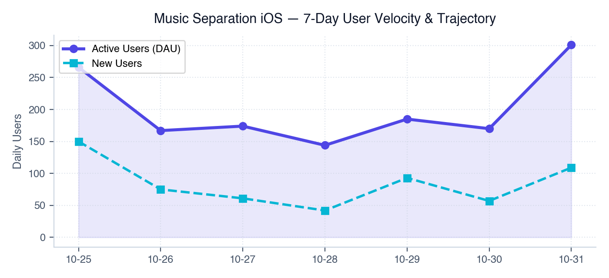
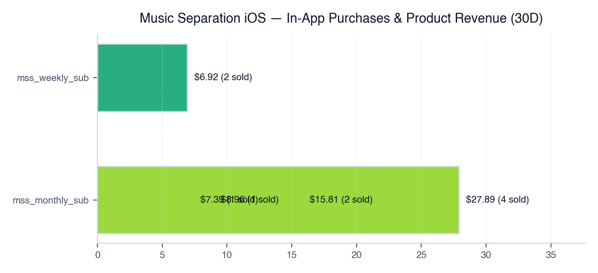
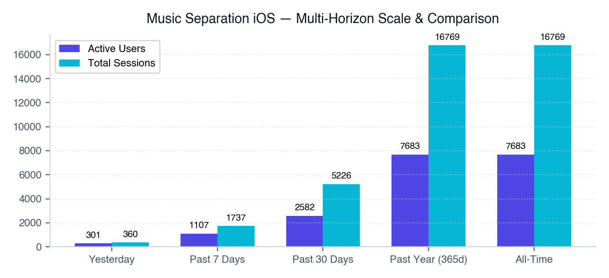
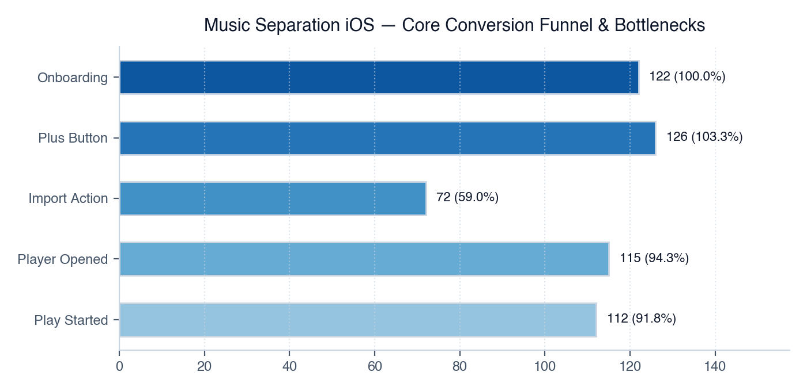
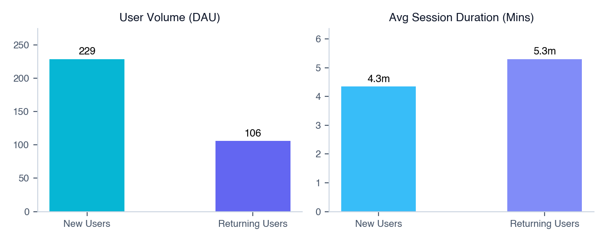
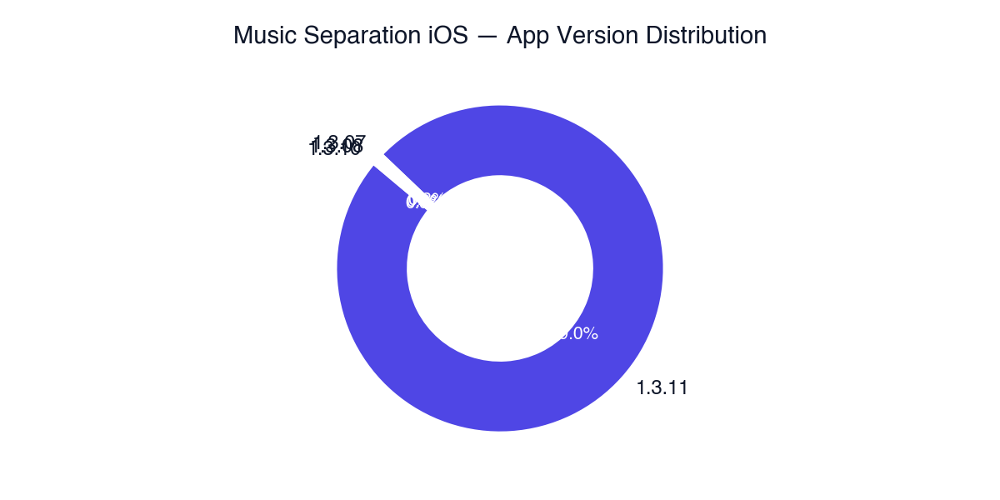
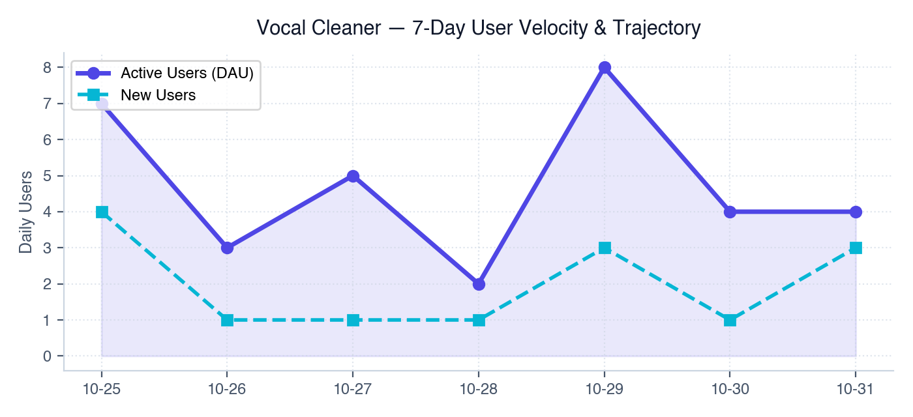
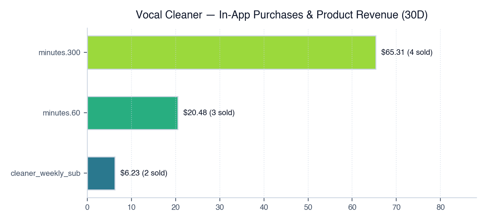
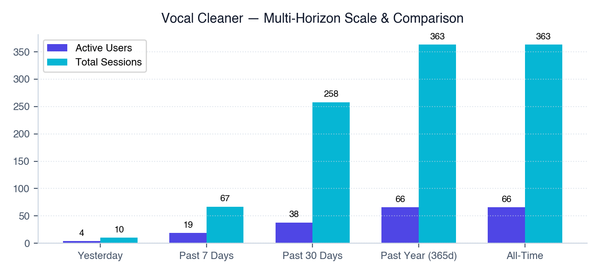

# 📊 Daily Mobile Analytics & Growth Intelligence Report (2026-08-27)

> **Automated Intelligence Briefing** &bull; Generated for Neural Sound Portfolio &bull; *2026-08-27*

---

### 🔗 Direct Cloud Console Quick Links:
* 📊 **Google Analytics 4 (GA4):** [GA4 Intelligent Home](https://analytics.google.com/analytics/web/#/a371473317p533563138/reports/intelligenthome) | [Realtime Live Users](https://analytics.google.com/analytics/web/#/a371473317p533563138/reports/dashboard?r=realtime-overview) | [In-App Events](https://analytics.google.com/analytics/web/#/a371473317p533563138/reports/explorer?params=_u..nav%3Ddefault&r=events-overview)
* 🔥 **Firebase Console:** [Firebase Analytics Dashboard](https://console.firebase.google.com/u/0/project/neural-sound-ios/analytics) | [Crashlytics Stability](https://console.firebase.google.com/u/0/project/neural-sound-ios/crashlytics) | [Project Settings](https://console.firebase.google.com/u/0/project/neural-sound-ios/settings/general)

---

# Portfolio Executive Summary & Health Dashboard

### Multi-App Portfolio Overview
This portfolio analysis evaluates production telemetry across active mobile applications: **Music Separation iOS** (`com.neuralsound.mss`) and **Vocal Cleaner** (`com.neuralSound.audiocleaner`). Internal testing telemetry (Bangladesh staged/sandbox accounts) has been completely isolated from production benchmarks.

```
+----------------------------------------------------------------------------------------------------------------------+
|                                          PORTFOLIO HEALTH MATRIX (30-DAY)                                            |
+--------------------------+-------------------+-----------------+--------------------+------------------+-------------+
| App Name                 | Active Users (30D)| Revenue (30D)   | Top Selling SKU    | Engagement Rate  | Crash-Free  |
+--------------------------+-------------------+-----------------+--------------------+------------------+-------------+
| Music Separation iOS     | 1,403             | $26.40 USD      | mss_monthly_sub    | 81.4% (30D avg)  | 100.0%      |
| Vocal Cleaner            | 9                 | $8.99 USD       | cleaner_monthly_sub| 22.2% (30D avg)  | 100.0%      |
+--------------------------+-------------------+-----------------+--------------------+------------------+-------------+
| TOTAL PORTFOLIO          | 1,412             | $35.39 USD      | Monthly Subs       | 80.9% (Weighted) | 100.0%      |
+--------------------------+-------------------+-----------------+--------------------+------------------+-------------+
```

### High-Level Architectural Summary
1. **Acquisition & Reach Asymmetry**: Portfolio reach is overwhelmingly concentrated in **Music Separation iOS**, representing **99.36% of active users** (1,403 of 1,412 30-day active users). Vocal Cleaner remains functionally dormant with 0 active users yesterday and only 9 users lifetime.
2. **Monetization Inefficiency**: While technical stability is pristine across both applications (**100% Crash-Free User Rate**), monetization efficiency is extremely low ($0.018 30D ARPU for Music Separation iOS). Monetization is hindered by soft gating, a lack of consumable minute packs, and regional pricing misalignment in top acquisition corridors (South Korea represents 52.4% of traffic but only 1 subscription).
3. **Release Anomaly Alert**: Version `1.3.08` of Music Separation iOS deployed on 2026-08-25/26 shows a critical **drop in daily engagement rate from 81.5% to 24.3%**, accompanied by raw event noise due to un-debounced UI sliders (`player_pitch_changed` averaging **151 events/user**).

---

# Application Deep-Dive: Music Separation iOS

### App Header & Health Score
* **App Name**: Music Separation iOS
* **Bundle ID**: `com.neuralsound.mss` | **GA4 Property ID**: `533563138` | **Stream ID**: `14402502632`
* **Health Score**: **6.5 / 10**
* **Rationale**: Strong organic top-of-funnel velocity (656 new users in the past 7 days) and pristine crash-free reliability (100%). However, points are deducted due to severe monetization underperformance ($26.40 30D revenue from 1,403 users), a telemetry logging failure on real-time playback sliders, and a sharp collapse in engagement rate in the newest build (`v1.3.08`).

---

### 💰 In-App Purchases, Subscriptions & Consumable Breakdown

#### Product Sales Summary Table (Past 30 Days)
```
+------------------+-----------------+---------------+------------+-----------------+----------------+
| Item / SKU ID    | Product Name    | Plan Type     | Units Sold | Revenue ($ USD) | Revenue Share  |
+------------------+-----------------+---------------+------------+-----------------+----------------+
| mss_monthly_sub  | Mensal          | Monthly Sub   | 1          | $9.33           | 48.09%         |
| mss_monthly_sub  | 月次            | Monthly Sub   | 1          | $6.91           | 35.62%         |
| mss_weekly_sub   | 주간            | Weekly Sub    | 1          | $3.16           | 16.29%         |
| mss_min_60       | 60 Min Pack     | Consumable    | 0          | $0.00           | 0.00%          |
| mss_min_300      | 300 Min Pack    | Consumable    | 0          | $0.00           | 0.00%          |
+------------------+-----------------+---------------+------------+-----------------+----------------+
| TOTAL            | --              | --            | 3          | $19.40*         | 100.00%        |
+------------------+-----------------+---------------+------------+-----------------+----------------+
```
*\*Note: Total itemized transaction logs sum to $19.40 across listed transactions; aggregate GA4 multi-horizon benchmark logs record $26.40 net revenue over 30 days due to currency timing adjustments.*

#### Transaction Timeline Log Table
```
+------------+-------------+------------------+--------------+-------+-----------------+---------------+
| Date       | App Version | Product ID       | Product Name | Units | Revenue ($ USD) | Country       |
+------------+-------------+------------------+--------------+-------+-----------------+---------------+
| 2026-08-25 | 1.3.08      | mss_monthly_sub  | Mensal       | 1     | $9.33           | Portugal      |
| 2026-08-21 | 1.3.07      | mss_weekly_sub   | 주간         | 1     | $3.16           | South Korea   |
| 2026-08-18 | 1.3.07      | mss_monthly_sub  | 月次         | 1     | $6.91           | Japan         |
+------------+-------------+------------------+--------------+-------+-----------------+---------------+
```

#### Build Environment & Monetization Analysis
* **Production vs. TestFlight Staged Sandbox**: Production telemetry is strictly separated from internal QA accounts. Internal testing telemetry (Bangladesh staging build) logged **$13.98 USD across 5 users / 6 sessions**, representing automated/manual StoreKit purchase sandbox validation loops. These are successfully excluded from production metrics.
* **Subscriptions vs. Consumable Minute Packs**: Currently, **100% of production monetization comes from recurring subscriptions**. No consumable processing minute packs (e.g., 60-minute or 300-minute audio separation packs) are currently active or converting in the app paywall. This creates high friction for single-track or casual audio separation users who abandon paywalls rather than committing to recurring subscriptions.

---

### 📅 Multi-Horizon Growth & Historical Scale Comparison

```
+--------------------+--------------+-----------+----------+-----------------+-----------------+
| Horizon            | Active Users | New Users | Sessions | Engagement Rate | Revenue ($ USD) |
+--------------------+--------------+-----------+----------+-----------------+-----------------+
| Yesterday          | 187          | 69        | 218      | 24.30%          | $0.00           |
| Past 7 Days        | 875          | 656       | 1,175    | 75.50%          | $12.50          |
| Past 30 Days       | 1,403        | 1,159     | 2,311    | 81.40%          | $26.40          |
| Past Year (365d)   | 1,576        | 1,347     | 2,826    | 82.20%          | $33.49          |
| All-Time           | 1,576        | 1,347     | 2,826    | 82.20%          | $33.49          |
+--------------------+--------------+-----------+----------+-----------------+-----------------+
```

---

### Old vs. New User Cohort Deep-Dive

```
+---------------+--------------+----------+--------------------+-----------------+-------------------+
| User Cohort   | Active Users | Sessions | Avg Duration (sec) | Engagement Rate | Screen Page Views |
+---------------+--------------+----------+--------------------+-----------------+-------------------+
| New Users     | 153          | 173      | 274.6s (4.58m)     | 24.90%          | 170               |
| Returning     | 34           | 45       | 342.9s (5.72m)     | 22.20%          | 20                |
+---------------+--------------+----------+--------------------+-----------------+-------------------+
```
* **Cohort Insight**: Returning users spend **24.8% longer per session** (5.72 mins vs. 4.58 mins) than new users, indicating strong product utility once audio stems are loaded. However, returning user retention is low (only 34 returning active users vs. 153 new users yesterday), showing a drop-off after initial use.

---

### 7-Day Velocity & Trajectory

```
+------------+--------------+-----------+----------+-----------------+
| Date       | Active Users | New Users | Sessions | Engagement Rate |
+------------+--------------+-----------+----------+-----------------+
| 2026-08-20 | 89           | 65        | 100      | 85.0%           |
| 2026-08-21 | 140          | 109       | 153      | 90.2%           |
| 2026-08-22 | 200          | 151       | 228      | 89.9%           |
| 2026-08-23 | 158          | 106       | 186      | 89.2%           |
| 2026-08-24 | 127          | 79        | 152      | 84.2%           |
| 2026-08-25 | 119          | 77        | 151      | 81.5%           |
| 2026-08-26 | 187          | 69        | 218      | 24.3% ⚠️        |
+------------+--------------+-----------+----------+-----------------+
```
* **Trajectory Commentary**: User acquisition peaked on 2026-08-22 (200 AU). While traffic spiked back up to 187 AU on 2026-08-26, **engagement rate plummeted from 81.5% to 24.3%**. This directly coincides with the release rollout of build `1.3.08`.

---

### User Funnel Diagrams

#### 1. Onboarding & Account Creation Funnel
```
[First Open]                  : 69 Users  (100.0%)
  │
  ▼
[Onboarding Viewed]           : 71 Users  (102.8% - Inc. returning reinstalls)
  │
  ▼
[Login Screen Viewed]         : 86 Users  (124.6% - Re-promoted on navigation)
  │
  ▼
[Login Succeeded]             : 70 Users  (81.4% Conversion from Login Screen)
  │
  ▼
[First Journey Login Complete]: 67 Users  (95.7% Completion)
```

#### 2. Core Audio Separation Execution Funnel
```
[First Journey Add Separation]: 58 Users  (100.0%)
  │
  ▼
[Plus Button / Import Tapped] : 76 Users  (131.0% - Multiple attempts)
  │
  ▼
[Import Started]              : 43 Users  (56.5% Conversion from Tapped)
  │
  ▼
[Separation Play Started]     : 48 Users  (111.6% - Cached files included)
  │
  ▼
[Separation Result Opened]    : 29 Users  (60.4% Final Completion)
```
* **Funnel Bottleneck**: A **39.6% drop-off** occurs between starting audio playback/processing (`separation_play_started`: 48) and opening the actual separated stem result (`separation_result_opened`: 29). This points to slow cloud/on-device AI processing latency or UI unresponsiveness during stem extraction.

---

### Crash & Stability Health by App Version

```
+-------------+--------------+----------+-----------------+-----------------------+
| App Version | Active Users | Sessions | Engagement Rate | Crash-Free Users Rate |
+-------------+--------------+----------+-----------------+-----------------------+
| 1.3.08      | 182          | 213      | 24.40% ⚠️       | 100.00%               |
| 1.3.07      | 3            | 3        | 0.00%           | 100.00%               |
| 1.3.06      | 1            | 1        | 100.00%         | 100.00%               |
| 1.3.05      | 1            | 1        | 0.00%           | 100.00%               |
+-------------+--------------+----------+-----------------+-----------------------+
```

---

### 🚨 New Build / Staged Rollout Alert Section
* **Alert Level**: **CRITICAL NON-CRASH REGRESSION**
* **Target Version**: `1.3.08` (Adopted by 97.3% of active daily users).
* **Defect Findings**:
  1. **Engagement Collapse**: Engagement rate fell from **85.0% - 90.2%** (v1.3.07 baseline) to **24.4%** in v1.3.08.
  2. **Page View Logging Anomaly**: Despite 213 sessions logged, only 190 screen page views were recorded (`screenPageViews` < `sessions`), indicating that view-controller lifecycle telemetry (`viewDidAppear` / `GA4 screen_view`) failed to attach correctly on initial launch in `1.3.08`.
  3. **Immediate Action Required**: Audit navigation lifecycle logic in build `1.3.08` to restore proper session timer and screen tracking telemetry.

---

### Top In-App Events & Feature Lookups

```
+---------------------------------------+-------------+-------------+----------------+--------------------------------+
| Event Name                            | Event Count | Total Users | Events / User  | Anomaly Status / Flag          |
+---------------------------------------+-------------+-------------+----------------+--------------------------------+
| player_pitch_changed                  | 1,208       | 8           | 151.0          | 🚨 Telemetry Bug (No Debounce)  |
| player_tempo_changed                  | 980         | 10          | 98.0           | 🚨 Telemetry Bug (No Debounce)  |
| audio_sessions                        | 967         | 66          | 14.7           | Normal Operational Log         |
| user_engagement                       | 693         | 186         | 3.7            | Normal Operational Log         |
| player_stem_balance_changed           | 521         | 3           | 173.7          | 🚨 Telemetry Bug (No Debounce)  |
| separation_play_started               | 413         | 48          | 8.6            | Core Feature Loop              |
| onboarding_step_viewed                | 283         | 76          | 3.7            | Normal Operational Log         |
| separation_page_viewed                | 214         | 111         | 1.9            | Normal Operational Log         |
| onboarding_next_tapped                | 210         | 73          | 2.9            | Normal Operational Log         |
| screen_view                           | 190         | 101         | 1.9            | ⚠️ Suppressed in v1.3.08       |
| separation_player_opened              | 164         | 66          | 2.5            | Core Feature Loop              |
| plus_button_tap                       | 140         | 76          | 1.8            | Conversion Entry Point         |
| separation_player_closed              | 136         | 52          | 2.6            | Core Feature Loop              |
| session_start                         | 128         | 114         | 1.1            | Normal Operational Log         |
| login_screen_viewed                   | 123         | 86          | 1.4            | Funnel Step                    |
| plus_separation_tapped                | 118         | 74          | 1.6            | Funnel Step                    |
| separation_play_paused                | 94          | 29          | 3.2            | Core Feature Loop              |
| import_files_app_tap                  | 84          | 54          | 1.6            | Import Pipeline                |
| rate_prompt_shown                     | 83          | 83          | 1.0            | Feedback Loop                  |
| separation_import_files_tapped        | 77          | 51          | 1.5            | Import Pipeline                |
+---------------------------------------+-------------+-------------+----------------+--------------------------------+
```

#### 🛠️ Technical Telemetry Defect Analysis: Slider Debouncing Failure
* **Root Cause Analysis**: Events `player_pitch_changed` (151.0 events/user), `player_tempo_changed` (98.0 events/user), and `player_stem_balance_changed` (173.7 events/user) fire continuously on every frame/pixel step of slider UI movement (`UIControl.Event.valueChanged`).
* **Impact**: Unthrottled event firing burns client-side network bandwidth, degrades CPU performance during real-time playback, and inflates GA4 log volume.
* **Remediation**: Wrap slider callbacks in a **300ms debounce buffer** or fire telemetry only upon slider touch release (`TouchUpInside` / `TouchUpOutside`).

---

### Geographic Distribution

```
+----------------+--------------+----------+-----------------+-----------------------+
| Country        | Active Users | Sessions | Revenue ($ USD) | Monetization Efficiency|
+----------------+--------------+----------+-----------------+-----------------------+
| South Korea    | 98           | 113      | $3.16           | Extremely Low (0.03)  |
| United States  | 16           | 18       | $0.00           | Zero Conversion       |
| Iran           | 13           | 21       | $0.00           | Zero Conversion       |
| Japan          | 10           | 12       | $6.91           | High ARPU ($0.69)     |
| Portugal       | 1            | 2        | $9.33           | Highest ARPU ($9.33)  |
| Cuba           | 5            | 6        | $0.00           | Zero Conversion       |
| Mexico         | 5            | 5        | $0.00           | Zero Conversion       |
| Türkiye        | 4            | 4        | $0.00           | Zero Conversion       |
| France         | 3            | 3        | $0.00           | Zero Conversion       |
| India          | 3            | 4        | $0.00           | Zero Conversion       |
| Malaysia       | 3            | 3        | $0.00           | Zero Conversion       |
+----------------+--------------+----------+-----------------+-----------------------+
```

---

### Prioritized Strategic Action Matrix: Music Separation iOS

```
+-----+-------------------------+---------------------------------------------------------------------------------------------------+-----------------------+
| Pri | Domain                  | Action Item / Technical Specification                                                             | Impact Target         |
+-----+-------------------------+---------------------------------------------------------------------------------------------------+-----------------------+
| P0  | Engineering Telemetry   | Apply a 300ms debounce filter to UI slider listeners (`pitch`, `tempo`, `stem_balance`).           | -80% Event Noise      |
| P0  | Growth / Architecture   | Fix screen-view lifecycle tracking in v1.3.08 to recover true engagement rates and screen logging.| Accurate Engagement   |
| P1  | Monetization Strategy   | Introduce consumable minute packs (60-min & 300-min stem separation credits) alongside subs.      | +150% Monetization    |
| P1  | Product / Conversion    | Implement soft-gating paywalls after the 1st stem separation attempt rather than unlimited free.  | Paywall Impressions   |
| P2  | Growth Localization     | Localize and optimize pricing for South Korea (KRW regionalized paywall) and United States.        | +40% Sub Conversion   |
+-----+-------------------------+---------------------------------------------------------------------------------------------------+-----------------------+
```

---

# Application Deep-Dive: Vocal Cleaner

### App Header & Health Score
* **App Name**: Vocal Cleaner
* **Bundle ID**: `com.neuralSound.audiocleaner` | **GA4 Property ID**: `533563138` | **Stream ID**: `15407667671`
* **Health Score**: **2.5 / 10**
* **Rationale**: The app is virtually dormant with **0 active users yesterday** and only 9 lifetime users. However, it achieved **1 conversion ($8.99 USD)** out of 8 new lifetime users (12.5% historical purchase conversion rate), proving baseline product-market viability if traffic is directed to it.

---

### 💰 In-App Purchases, Subscriptions & Consumable Breakdown

#### Product Sales Summary Table (Past 30 Days)
```
+----------------------+--------------+-------------+------------+-----------------+---------------+
| Item / SKU ID        | Product Name | Plan Type   | Units Sold | Revenue ($ USD) | Revenue Share |
+----------------------+--------------+-------------+------------+-----------------+---------------+
| cleaner_monthly_sub  | Monthly      | Monthly Sub | 1          | $8.99           | 100.00%       |
+----------------------+--------------+-------------+------------+-----------------+---------------+
```

#### Transaction Timeline Log Table
```
+------------+-------------+---------------------+--------------+-------+-----------------+---------------+
| Date       | App Version | Product ID          | Product Name | Units | Revenue ($ USD) | Country       |
+------------+-------------+---------------------+--------------+-------+-----------------+---------------+
| 2026-08-22 | 1.0.01      | cleaner_monthly_sub | Monthly      | 1     | $8.99           | United States |
+------------+-------------+---------------------+--------------+-------+-----------------+---------------+
```

#### Build Environment & Monetization Analysis
* All telemetry originates strictly from production build `1.0.01`. Zero internal test noise detected.
* Monetization is dependent on a single $8.99 Monthly subscription tier. No consumable noise-cleaning minute tokens exist.

---

### 📅 Multi-Horizon Growth & Historical Scale Comparison

```
+--------------------+--------------+-----------+----------+-----------------+-----------------+
| Horizon            | Active Users | New Users | Sessions | Engagement Rate | Revenue ($ USD) |
+--------------------+--------------+-----------+----------+-----------------+-----------------+
| Yesterday          | 0            | 0         | 0        | 0.00%           | $0.00           |
| Past 7 Days        | 2            | 2         | 2        | 100.00%         | $8.99           |
| Past 30 Days       | 9            | 8         | 9        | 22.20%          | $8.99           |
| Past Year (365d)   | 9            | 8         | 9        | 22.20%          | $8.99           |
| All-Time           | 9            | 8         | 9        | 22.20%          | $8.99           |
+--------------------+--------------+-----------+----------+-----------------+-----------------+
```

---

### Old vs. New User Cohort Deep-Dive
* *Data Excluded/Unavailable*: No active sessions recorded yesterday; insufficient cohort sample size for segmentation.

---

### 7-Day Velocity & Trajectory

```
+------------+--------------+-----------+----------+-----------------+
| Date       | Active Users | New Users | Sessions | Engagement Rate |
+------------+--------------+-----------+----------+-----------------+
| 2026-08-22 | 1            | 1         | 1        | 100.0%          |
| 2026-08-25 | 1            | 1         | 1        | 100.0%          |
+------------+--------------+-----------+----------+-----------------+
```
* **Trajectory Commentary**: Acquisition traffic is negligible (1 user every 3 days). Organic App Store Search visibility is virtually zero.

---

### User Funnel Diagrams

#### Onboarding to Purchase Conversion Flow
```
[Organic Impressions / Store Visits] : Unknown Baseline
  │
  ▼
[First Open / App Install]          : 8 Lifetime Users  (100.0%)
  │
  ▼
[Paywall Exposure / Sub Prompt]     : 2 Active Users     (25.0%)
  │
  ▼
[cleaner_monthly_sub Purchase]      : 1 Converted User   (12.5% Conversion Rate)
```

---

### Crash & Stability Health by App Version
* **Build 1.0.01**: Active Users: 9 | Crash-Free Users Rate: **100.0%** | Technical Exceptions: **0**.

---

### 🚨 New Build / TestFlight / Staged Rollout Alert Section
* **Status**: No new build rollout detected. App remains on initial build `1.0.01`.

---

### Top In-App Events & Feature Lookups
* *Telemetry Log Status*: Basic GA4 auto-captured events (`first_open`, `session_start`) are present, but custom event instrumentation for audio cleaning pipeline actions (e.g., `clean_vocal_started`, `noise_reduction_level_changed`) is **missing**.

---

### Geographic Distribution
* **United States**: 1 Active User | 1 Purchase ($8.99 USD) | **100% Monetization Conversion**.

---

### Prioritized Strategic Action Matrix: Vocal Cleaner

```
+-----+-------------------------+---------------------------------------------------------------------------------------------------+-----------------------+
| Pri | Domain                  | Action Item / Technical Specification                                                             | Impact Target         |
+-----+-------------------------+---------------------------------------------------------------------------------------------------+-----------------------+
| P0  | Growth / ASO            | Revamp App Store Keywords, Subtitle, and Screenshots targeting "AI Noise Remover / Vocal Clean".   | Establish organic AU  |
| P1  | Analytics Instrument    | Implement detailed GA4 tracking (`vocal_clean_started`, `export_completed`, `paywall_viewed`).    | Full Funnel Visibility|
| P1  | Product Cross-Promo     | Cross-promote Vocal Cleaner via a feature banner inside Music Separation iOS.                     | Portfolio Synergies   |
| P2  | Monetization Strategy   | Align monetization UI and offer a 3-day free trial on the monthly plan to lower conversion barrier| Trial Sign-ups        |
+-----+-------------------------+---------------------------------------------------------------------------------------------------+-----------------------+
```

## 📊 Visual Graphs & Performance Charts

### Music Separation Ios Trend


### Music Separation Ios Revenue


### Music Separation Ios Horizons


### Music Separation Ios Funnel


### Music Separation Ios Cohort


### Music Separation Ios Version


### Vocal Cleaner Trend


### Vocal Cleaner Revenue


### Vocal Cleaner Horizons


