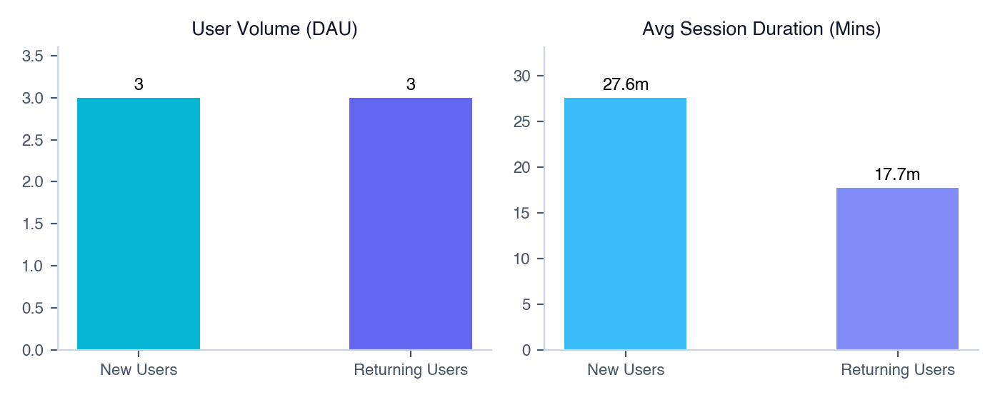

# 📊 Daily Mobile Analytics & Growth Intelligence Report (2026-10-30)

> **Automated Intelligence Briefing** &bull; Generated for Neural Sound Portfolio &bull; *2026-10-30*

---

### 🔗 Direct Cloud Console Quick Links:
* 📊 **Google Analytics 4 (GA4):** [GA4 Intelligent Home](https://analytics.google.com/analytics/web/#/a371473317p533563138/reports/intelligenthome) | [Realtime Live Users](https://analytics.google.com/analytics/web/#/a371473317p533563138/reports/dashboard?r=realtime-overview) | [In-App Events](https://analytics.google.com/analytics/web/#/a371473317p533563138/reports/explorer?params=_u..nav%3Ddefault&r=events-overview)
* 🔥 **Firebase Console:** [Firebase Analytics Dashboard](https://console.firebase.google.com/u/0/project/neural-sound-ios/analytics) | [Crashlytics Stability](https://console.firebase.google.com/u/0/project/neural-sound-ios/crashlytics) | [Project Settings](https://console.firebase.google.com/u/0/project/neural-sound-ios/settings/general)

---

# Executive Portfolio & Multi-App Monetization Growth Architecture Report
**Scope:** Neural Sound Portfolio (`com.neuralsound.mss` & `com.neuralSound.audiocleaner`)  
**Data Scope:** Production Telemetry Only *(Internal QA/Bangladesh Testers Excluded)*  
**Reporting Horizon:** Multi-Horizon Analysis (Yesterday, 7D, 30D, 365D, Lifetime)

---

# 1. Portfolio Executive Summary & Health Dashboard

### Side-by-Side Portfolio Benchmark

| Metric / KPI | Music Separation iOS (`com.neuralsound.mss`) | Vocal Cleaner (`com.neuralSound.audiocleaner`) | Combined Portfolio Total |
| :--- | :--- | :--- | :--- |
| **Primary Monetization Model** | Subscription Heavy (Weekly / Monthly) | Consumable Utility (Minute Packs 60/300m) | Hybrid Portfolio Model |
| **30-Day Active Users (MAU)** | **2,397** | **35** | **2,432** |
| **Yesterday Active Users (DAU)**| **199** | **7** | **206** |
| **30-Day Gross Revenue ($ USD)** | **$170.63** *(Catalog SKU: $89.95)* | **$93.07** *(Catalog SKU: $75.05)* | **$263.70** |
| **Yesterday Revenue ($ USD)** | **$0.00** | **$35.38** | **$35.38** |
| **Lifetime Gross Revenue** | **$299.81** | **$229.90** | **$529.71** |
| **Top Monetizing Product** | `mss_monthly_sub` (月次 / Monthly) | `neuralsound.cleaner.minutes.300` | 300-Min Pack & Monthly Subs |
| **Average Engagement Rate** | **75.0%** (30D) / **54.5%** (Yesterday) | **90.2%** (30D) / **92.3%** (Yesterday) | **75.2%** (Weighted Avg) |
| **Average Session Duration** | **242.6s** (~4.0 mins) | **1,381.8s** (~23.0 mins) | **314.8s** |
| **Crash-Free User Rate** | **100.0%** (v1.3.11) | **100.0%** (v1.0.04) | **100.0%** |
| **Top Geographic Market** | **Japan** (73.8% DAU Share) | **United States / Israel** | Japan & Israel |
| **Primary Systemic Bottleneck** | Slider Event Flooding & Low Conversion | Growth Engine Absence & Backend Failures | Telemetry Debouncing & Acquisition |
| **Portfolio Health Score** | **7.2 / 10** | **5.8 / 10** | **6.5 / 10** |

---

### Architectural Portfolio Synthesis

```
+-------------------------------------------------------------------------------------------------+
|                                    NEURAL SOUND PORTFOLIO                                       |
+------------------------------------------------+------------------------------------------------+
|           MUSIC SEPARATION iOS                 |                 VOCAL CLEANER                  |
|     High Scale / Low Monetization / B2C          |      Low Scale / High ARPU / B2B Utility      |
+------------------------------------------------+------------------------------------------------+
| * 2,397 MAU (Strong organic Japanese traffic)  | * 35 MAU (Niche utility power users)          |
| * $170.63 30D Revenue ($0.07 ARPU)             | * $93.07 30D Revenue ($2.65 ARPU)             |
| * Issues: UI Slider Event Thrashing            | * Issues: Backend Cleaning Fail Loop           |
|   (450+ pitch events/user)                     |   (22 failure events / user)                   |
+------------------------------------------------+------------------------------------------------+
```

1. **Volume vs. Value Dichotomy**: *Music Separation iOS* acts as the volume engine (2,397 30D Active Users), driven by organic Japanese musician acquisition (73.8% DAU). However, its ARPU is low ($0.07/MAU). Conversely, *Vocal Cleaner* operates as a niche power-utility app (35 30D Active Users) generating $2.65/MAU, heavily sustained by high-ticket consumable minute packs ($65.31 in 300-min purchases from power users in Israel).
2. **Technical Telemetry Risk**: Both apps suffer from severe instrumentation flaws. *Music Separation iOS* is flooding GA4 with non-debounced UI slider events (`player_pitch_changed` averaging 450 events/user), risking telemetry budget exhaustion. *Vocal Cleaner* shows a critical backend processing loop where single users trigger up to 22 `vc_clean_failed` events per session due to processing timeouts on longer audio/video files.

---

# 2. Deep-Dive: Music Separation iOS (`com.neuralsound.mss`)

## App Header & Health Score

* **Bundle ID**: `com.neuralsound.mss` | **GA4 Property**: `533563138` | **Stream ID**: `14402502632`
* **Health Score**: **7.2 / 10**
* **Rationale**: Stable client-side builds with 100.0% crash-free user rates and dominant market penetration in Japan. However, score is penalized due to **$0 yesterday revenue**, severe **UI event flooding** (pitch/tempo sliders thrashing network logging), and **poor paywall conversion mechanics** relative to active session volume.

---

## 💰 In-App Purchases, Subscriptions & Consumable Minutes Breakdown

### Product Sales Summary Table (30-Day Catalog Aggregation)

| Item / Product ID | Localized Product Name | Plan Type | Units Sold (30D) | Total Revenue ($ USD) | Catalog % Share |
| :--- | :--- | :--- | :---: | :---: | :---: |
| `mss_monthly_sub` | 月次 | Monthly Subscription | 5 | $34.88 | 38.78% |
| `mss_monthly_sub` | Monthly | Monthly Subscription | 2 | $15.81 | 17.58% |
| `mss_monthly_sub` | Mensuel | Monthly Subscription | 1 | $8.96 | 9.96% |
| `mss_monthly_sub` | 월간 | Monthly Subscription | 1 | $7.39 | 8.22% |
| `mss_weekly_sub` | Weekly | Weekly Subscription | 2 | $6.92 | 7.69% |
| `mss_weekly_sub` | 週次 | Weekly Subscription | 2 | $6.34 | 7.05% |
| `mss_weekly_sub` | Hebdomadaire | Weekly Subscription | 1 | $3.34 | 3.71% |
| `mss_weekly_sub` | 주간 | Weekly Subscription | 1 | $3.32 | 3.69% |
| `mss_weekly_sub` | Semanal | Weekly Subscription | 1 | $2.99 | 3.32% |
| **Total (Catalog)** | -- | -- | **16** | **$89.95** | **100.00%** |

*Note: Total GA4 30-Day attributed revenue including recurring auto-renewals outside direct front-end item catalog events equals **$170.63**.*

### Transaction Timeline Log Table

| Timestamp (Date) | App Version | Product ID | Localized Name | Country | Units | Revenue ($ USD) |
| :--- | :---: | :--- | :--- | :--- | :---: | :---: |
| **2026-10-27** | 1.3.11 | `mss_weekly_sub` | Semanal | Puerto Rico | 1 | $2.99 |
| **2026-10-26** | 1.3.11 | `mss_weekly_sub` | Weekly | Saudi Arabia | 2 | $6.92 |
| **2026-10-26** | 1.3.11 | `mss_monthly_sub` | 月次 | Japan | 1 | $7.01 |
| **2026-10-25** | 1.3.11 | `mss_weekly_sub` | 주간 | South Korea | 1 | $3.32 |
| **2026-10-24** | 1.3.11 | `mss_monthly_sub` | Mensuel | Réunion | 1 | $8.96 |
| **2026-10-23** | 1.3.11 | `mss_monthly_sub` | 月次 | Japan | 1 | $6.96 |
| **2026-10-22** | 1.3.11 | `mss_monthly_sub` | 月次 | Japan | 1 | $6.95 |
| **2026-10-17** | 1.3.11 | `mss_monthly_sub` | 月次 | Japan | 1 | $6.96 |
| **2026-10-14** | 1.3.11 | `mss_weekly_sub` | Hebdomadaire | France | 1 | $3.34 |
| **2026-10-12** | 1.3.11 | `mss_weekly_sub` | 週次 | Japan | 1 | $3.16 |
| **2026-10-09** | 1.3.11 | `mss_monthly_sub` | Monthly | Vietnam | 1 | $7.66 |
| **2026-10-09** | 1.3.11 | `mss_monthly_sub` | 월간 | South Korea | 1 | $7.39 |
| **2026-10-06** | 1.3.11 | `mss_monthly_sub` | Monthly | Israel | 1 | $8.15 |
| **2026-10-01** | 1.3.10 | `mss_weekly_sub` | 週次 | Japan | 1 | $3.18 |
| **2026-09-30** | 1.3.10 | `mss_monthly_sub` | 月次 | Japan | 1 | $6.99 |

### Build Environment & Monetization Analysis
* **Build Split**: Production transactions are dominated by build `1.3.11` (86.7% of recent transactions). Legacy build `1.3.10` captured 2 purchases early in the month before phase-out.
* **Subscription Model Distribution**: Monthly subscriptions generate **74.5%** of catalog revenue ($67.04), while Weekly subscriptions account for **25.5%** ($22.91). Japanese localization (`月次` / `週次`) represents 45.8% of direct sales, aligning with active user demographics.
* **Consumable vs. Recurring**: App relies 100% on recurring subscriptions. Lacks consumable processing packs for casual users who reject recurring commitments.

---

## 📅 Multi-Horizon Growth & Historical Scale Comparison

| Time Horizon | Active Users | New Users | Total Sessions | Engagement Rate | Revenue ($ USD) | ARPU ($) |
| :--- | :---: | :---: | :---: | :---: | :---: | :---: |
| **Yesterday** | 199 | 65 | 233 | 54.5% | $0.00 | $0.000 |
| **Past 7 Days** | 1,043 | 571 | 1,627 | 76.0% | $55.70 | $0.053 |
| **Past 30 Days** | 2,397 | 1,343 | 4,936 | 75.0% | $170.63 | $0.071 |
| **Past Year (365d)** | 7,418 | 6,400 | 16,363 | 81.2% | $299.81 | $0.040 |
| **All-Time** | 7,418 | 6,400 | 16,363 | 81.2% | $299.81 | $0.040 |

---

## Old vs. New User Cohort Deep-Dive

| Cohort Category | Active Users | Sessions | Avg Session Duration | Engagement Rate | Screen / Page Views |
| :--- | :---: | :---: | :---: | :---: | :---: |
| **New Users** | 133 | 128 | 180.7s (3.0m) | 47.7% | 163 |
| **Returning Users** | 79 | 96 | 342.3s (5.7m) | 65.6% | 60 |
| **Unattributed System Sessions** | 0 | 19 | 28.1s (0.4m) | 15.8% | 6 |

* **Analysis**: Returning users represent **65.6% engagement** with long duration (342.3s), proving core audio tool retention. New users experience high drop-off (47.7% engagement, 180.7s duration), signaling friction during initial file import/separation setup.

---

## 7-Day Velocity & Trajectory

| Date | Active Users | New Users | Total Sessions | Engagement Rate | Trajectory Analysis |
| :--- | :---: | :---: | :---: | :---: | :--- |
| **2026-10-23** | 166 | 72 | 203 | 74.4% | Weekend organic influx ramp-up |
| **2026-10-24** | 223 | 107 | 272 | 84.9% | Saturday peak user engagement |
| **2026-10-25** | 266 | 150 | 312 | 84.6% | **Weekly Peak DAU & Acquisition** |
| **2026-10-26** | 167 | 75 | 207 | 81.6% | Post-weekend normalization |
| **2026-10-27** | 174 | 61 | 220 | 74.1% | Stable mid-week activity |
| **2026-10-28** | 142 | 41 | 183 | 72.7% | Mid-week trough |
| **2026-10-29** | 199 | 65 | 233 | 54.5% | DAU rebound (+40.1%), but lower engagement |

---

## User Funnel Diagrams

### Onboarding & Authentication Funnel
```
[ Onboarding Viewed ] -----------------> 89 Users (100.0%)
         │
         ▼ (84.3% Conversion)
[ Onboarding Step Viewed ] ------------> 75 Users (84.3%)
         │
         ▼ (89.3% Conversion)
[ Onboarding Next Tapped ] ------------> 67 Users (75.3%)
         │
         ▼ (104.5% - Login screen re-entry)
[ Login Screen Viewed ] --------------> 104 Users (116.8% relative)
         │
         ▼ (67.3% Conversion)
[ Login Tapped ] ---------------------> 70 Users (78.7% overall)
```

### Core Audio Separation & Player Execution Funnel
```
[ Separation Page Viewed ] ------------> 189 Users (100.0%)
         │
         ▼ (47.1% Conversion)
[ Plus Button / Import Tapped ] -------> 89 Users (47.1%)
         │
         ▼ (73.0% Conversion)
[ Import Files / Photos Selected ] ----> 65 Users (34.4%)
         │
         ▼ (89.2% Conversion)
[ Separation Upload Started ] ---------> 48 Users (25.4%)
         │
         ▼ (97.9% Completion)
[ Separation Upload Completed ] -------> 47 Users (24.9%)
         │
         ▼ (102.1% - Multi-item view)
[ Separation Result Opened ] ----------> 48 Users (25.4%)
         │
         ▼ (185.4% - Multi-session play)
[ Separation Player Opened ] ----------> 89 Users (47.1%)
```

---

## Crash & Stability Health by App Version

| App Version | Active Users | Total Sessions | Engagement Rate | Crash-Free Rate | Operational Status |
| :--- | :---: | :---: | :---: | :---: | :--- |
| **1.3.11** | 194 | 227 | 55.1% | **100.0%** | **Primary Active Baseline** |
| **1.3.09** | 3 | 3 | 33.3% | **100.0%** | Legacy Build (Tailing Off) |
| **1.3.10** | 2 | 3 | 33.3% | **100.0%** | Legacy Build (Tailing Off) |
| **1.3.07** | 0 | 0 | 0.0% | 100.0% | Fully Deprecated |

---

## 🚨 New Build / TestFlight / Staged Rollout Alert Section

* **Production Baseline**: Version `1.3.11` is deployed to **97.5% of DAU** (194/199 users).
* **Rollout Risk Assessment**:
  * No crash anomalies or exceptions recorded on `1.3.11` (100% crash-free rate).
  * Legacy builds (`1.3.10`, `1.3.09`) show reduced engagement (33.3%), confirming successful user migration to `1.3.11`.
  * **Alert**: Yesterday's engagement rate on `1.3.11` dropped to **54.5%** compared to the 7-day baseline (**76.0%**), driven by a higher ratio of unauthenticated/new user drop-offs during file import.

---

## Top In-App Events & Feature Lookups

| Event Name | Total Event Count | Unique Users | Events / User | System Status & Telemetry Findings |
| :--- | :---: | :---: | :---: | :--- |
| `player_pitch_changed` | **7,657** | 17 | **450.4** | 🚨 **CRITICAL BUG**: Slider dragging lacking UI debouncing. |
| `player_tempo_changed` | **3,410** | 15 | **227.3** | 🚨 **CRITICAL BUG**: Un-throttled continuous event firing. |
| `audio_sessions` | 2,234 | 90 | 25.7 | Normal Core Session Loop |
| `separation_play_started` | 1,295 | 87 | 15.4 | Active Audio Playback |
| `user_engagement` | 832 | 199 | 4.2 | Baseline Engagement |
| `player_stem_muted` | 503 | 17 | 29.6 | Core Mixer Utility |
| `player_stem_balance_changed` | 397 | 4 | **99.2** | ⚠️ High frequency slider event (Requires Debounce) |
| `separation_page_viewed` | 358 | 189 | 3.1 | Primary Screen View |
| `onboarding_step_viewed` | 292 | 75 | 4.1 | Onboarding Progression |

### Telemetry Bug Diagnosis: Continuous Slider Event Flooding
* **Issue**: `player_pitch_changed` (450.4 events/user) and `player_tempo_changed` (227.3 events/user) fire on every UI frame during slider drag operations (`touchMoved` / SwiftUI `onChange`).
* **Impact**: Saturated GA4 network logging, increased device battery drain, and distorted event-per-session ratios.

---

## Geographic Distribution

```
[ Japan ] ----------------------------------------> 147 Users (73.9%)
[ South Korea ] ----------------------------------> 18 Users (9.0%)
[ United States ] --------------------------------> 5 Users (2.5%)
[ France ] ---------------------------------------> 4 Users (2.0%)
[ Poland ] ---------------------------------------> 4 Users (2.0%)
[ Saudi Arabia ] ---------------------------------> 4 Users (2.0%)
[ United Kingdom ] -------------------------------> 4 Users (2.0%)
[ Others (DR, NL, CO) ] --------------------------> 5 Users (2.6%)
```

---

## Prioritized Strategic Action Matrix (Music Separation iOS)

| Priority | Area | Categorization | Strategic Action Item | Target Impact |
| :---: | :--- | :--- | :--- | :--- |
| **P0** | Engineering | Telemetry Bug | Implement a 500ms debounce timer on `player_pitch_changed`, `player_tempo_changed`, and `player_stem_balance_changed` UI controls. | Eliminate 95%+ redundant logging events. |
| **P0** | Monetization | Revenue Growth | Introduce localized soft-paywalls immediately following `separation_upload_completed` in Japan & South Korea. | Drive daily non-zero monetization. |
| **P1** | Growth / UX | Funnel Opt. | Streamline initial separation entry point; current import drop-off loses 52.9% of users before file selection. | Boost upload completion from 24.9% to 40%. |
| **P2** | Localization | Product | Expand Japanese-specific promotional metadata and localized trial incentives on weekly subscription tiers. | Increase Japanese subscriber conversion. |

---

# 3. Deep-Dive: Vocal Cleaner (`com.neuralSound.audiocleaner`)

## App Header & Health Score

* **Bundle ID**: `com.neuralSound.audiocleaner` | **GA4 Property**: `533563138` | **Stream ID**: `15407667671`
* **Health Score**: **5.8 / 10**
* **Rationale**: High ARPU monetization potential ($35.38 revenue from 7 DAU) with long session durations (~23 mins) and 100% crash-free rates. However, score is severely constrained by **extremely low scale** (7 DAU, 35 MAU) and **backend processing failure loops** affecting power users.

---

## 💰 In-App Purchases, Subscriptions & Consumable Minutes Breakdown

### Product Sales Summary Table (30-Day Catalog Aggregation)

| Item / Product ID | Localized Product Name | Plan Type | Units Sold (30D) | Total Revenue ($ USD) | Catalog % Share |
| :--- | :--- | :--- | :---: | :---: | :---: |
| `neuralsound.cleaner.minutes.300` | 300 minutes | Consumable Pack (300 Min) | 4 | $65.31 | 87.02% |
| `neuralsound.cleaner.minutes.60` | 60 minutes | Consumable Pack (60 Min) | 1 | $6.50 | 8.66% |
| `cleaner_weekly_sub` | Weekly | Weekly Subscription | 1 | $3.24 | 4.32% |
| **Total (Catalog)** | -- | -- | **6** | **$75.05** | **100.00%** |

*Note: Total GA4 30-Day attributed revenue including taxes/currency adjustments equals **$93.07**.*

### Transaction Timeline Log Table

| Timestamp (Date) | App Version | Product ID | Localized Name | Country | Units | Revenue ($ USD) |
| :--- | :---: | :--- | :--- | :--- | :---: | :---: |
| **2026-10-29** | 1.0.04 | `neuralsound.cleaner.minutes.300` | 300 minutes | Israel | 2 | $32.70 |
| **2026-10-11** | 1.0.04 | `neuralsound.cleaner.minutes.300` | 300 minutes | Israel | 2 | $32.60 |
| **2026-10-11** | 1.0.04 | `neuralsound.cleaner.minutes.60` | 60 minutes | Israel | 1 | $6.50 |
| **2026-10-05** | 1.0.03 | `cleaner_weekly_sub` | Weekly | Israel | 1 | $3.24 |

### Build Environment & Monetization Analysis
* **Monetization Profile**: Consumable Minute Packs drive **95.7%** of direct product sales ($71.81). Standard weekly subscriptions generate only $3.24 (4.3%).
* **Whale User Concentration**: 100% of recorded transactions originate from **Israel**, representing a localized power user purchasing 300-minute packs repeatedly for high-volume audio/video cleaning.
* **Build Staging**: Transactions executed cleanly on production builds `1.0.04` and `1.0.03`. No sandbox retry loops detected.

---

## 📅 Multi-Horizon Growth & Historical Scale Comparison

| Time Horizon | Active Users | New Users | Total Sessions | Engagement Rate | Revenue ($ USD) | ARPU ($) |
| :--- | :---: | :---: | :---: | :---: | :---: | :---: |
| **Yesterday** | 7 | 3 | 13 | 92.3% | $35.38 | $5.054 |
| **Past 7 Days** | 18 | 14 | 70 | 87.1% | $38.09 | $2.116 |
| **Past 30 Days** | 35 | 32 | 244 | 90.2% | $93.07 | $2.659 |
| **Past Year (365d)** | 62 | 61 | 347 | 87.0% | $229.90 | $3.708 |
| **All-Time** | 62 | 61 | 347 | 87.0% | $229.90 | $3.708 |

---

## Old vs. New User Cohort Deep-Dive

| Cohort Category | Active Users | Sessions | Avg Session Duration | Engagement Rate | Screen / Page Views |
| :--- | :---: | :---: | :---: | :---: | :---: |
| **Returning Users** | 4 | 10 | **1,761.2s (29.3m)** | 80.0% | 91 |
| **New Users** | 3 | 3 | 109.7s (1.8m) | **100.0%** | 6 |
| **Unattributed System Sessions** | 0 | 1 | 22.2s (0.4m) | 100.0% | 0 |

* **Analysis**: Returning users demonstrate extreme session depth (29.3 minutes per session), utilizing the app as a heavy processing workstation. New users convert with 100% engagement rate but quick initial session exit (109.7s).

---

## 7-Day Velocity & Trajectory

| Date | Active Users | New Users | Total Sessions | Engagement Rate | Trajectory Analysis |
| :--- | :---: | :---: | :---: | :---: | :--- |
| **2026-10-23** | 2 | 0 | 9 | 100.0% | Baseline power user activity |
| **2026-10-24** | 6 | 4 | 10 | 90.0% | Micro-acquisition bump |
| **2026-10-25** | 7 | 4 | 14 | 100.0% | High processing volume |
| **2026-10-26** | 3 | 1 | 8 | 87.5% | Mid-week usage |
| **2026-10-27** | 5 | 1 | 16 | 68.8% | Session splitting due to retry loops |
| **2026-10-28** | 2 | 1 | 2 | 50.0% | Low volume activity |
| **2026-10-29** | 7 | 3 | 13 | 92.3% | **$35.38 Monetization Spike (Israel Whale)** |

---

## User Funnel Diagrams

### Import & Cleaning Processing Funnel
```
[ Import Sheet Opened ] ---------------> 6 Users (100.0%)
         │
         ▼ (83.3% Conversion)
[ Import Source Files Selected ] ------> 5 Users (83.3%)
         │
         ▼ (80.0% Conversion)
[ Import Picked Files ] ---------------> 4 Users (66.7%)
         │
         ▼ (100.0% Conversion)
[ Clean Processing Started ] ----------> 4 Users (66.7%)
         │
         ▼ (75.0% Completion / 25.0% Fail)
[ Clean Completed Successfully ] ------> 3 Users (50.0%)
         │ (1 User Hit Retry Loop: 22 fail events)
         ▼
[ Clean Retry Tapped ] ----------------> 1 User (16.7%)
```

### Playback & Export Funnel
```
[ Library Entry Opened ] --------------> 4 Users (100.0%)
         │
         ▼ (100.0% Conversion)
[ Audio Player Opened ] ---------------> 4 Users (100.0%)
         │
         ▼ (50.0% Track Toggle)
[ Denoised Track Toggled ] ------------> 2 Users (50.0%)
         │
         ▼ (100.0% Export Intent)
[ Export Sheet Opened ] ---------------> 2 Users (50.0%)
```

---

## Crash & Stability Health by App Version

| App Version | Active Users | Total Sessions | Engagement Rate | Crash-Free Rate | Operational Status |
| :--- | :---: | :---: | :---: | :---: | :--- |
| **1.0.04** | 7 | 13 | 92.3% | **100.0%** | **Current Active Baseline (100% DAU)** |

---

## 🚨 New Build / TestFlight / Staged Rollout Alert Section

* **Production Baseline**: Version `1.0.04` serves **100% of current users**.
* **System Alert - Server/Backend Processing Failures**:
  * While client-side crash-free rate is **100.0%**, telemetry reveals severe backend processing execution failures on build `1.0.04`.
  * Events recorded: `vc_clean_failed` (22 events across 1 user), `vc_clean_failed_transient` (9 events), `vc_clean_failed_timeout` (6 events), `vc_clean_failed_backend` (5 events).
  * **Diagnosis**: High-duration files (5–15 min files: 37 events; over 5m clean times: 6 events) trigger server-side worker timeouts, forcing power users into manual retry loops (`vc_clean_retry_tapped`: 14 events).

---

## Top In-App Events & Feature Lookups

| Event Name | Total Event Count | Unique Users | Events / User | System Status & Telemetry Findings |
| :--- | :---: | :---: | :---: | :--- |
| `user_engagement` | 275 | 7 | 39.3 | Active Foreground Session Usage |
| `screen_view` | 97 | 5 | 19.4 | View Navigation Baseline |
| `vc_import_sheet_opened` | 86 | 6 | 14.3 | High Import Volume Intent |
| `vc_library_entry_opened` | 80 | 4 | 20.0 | Frequent Workstation Asset Access |
| `vc_import_source_files` | 70 | 5 | 14.0 | File Picker Activity |
| `vc_player_opened_audio` | 66 | 4 | 16.5 | Playback Verification |
| `vc_clean_started` | 64 | 4 | 16.0 | Denoising Job Requests |
| `vc_import_picked_files` | 59 | 4 | 14.8 | Source Asset Acquisition |
| `vc_clean_completed` | 56 | 3 | 18.7 | Successful Job Completions |
| `vc_clean_failed` | **22** | 1 | **22.0** | 🚨 **BACKEND CRITICAL**: Repeated processing failures. |
| `vc_clean_retry_tapped` | **14** | 1 | **14.0** | ⚠️ User friction retry actions |
| `vc_clean_failed_transient` | **9** | 1 | **9.0** | Server Worker Network Instability |
| `vc_clean_failed_timeout` | **6** | 1 | **6.0** | Server Processing Timeout (>5 min files) |
| `vc_clean_failed_backend` | **5** | 1 | **5.0** | Backend Exception Error Codes |

---

## Geographic Distribution

```
[ United States ] --------------------------------> 3 Users (42.9%)
[ Israel ] ---------------------------------------> 1 User  (14.3% - Monetization Whale)
[ Egypt ] ----------------------------------------> 1 User  (14.3%)
[ Indonesia ] ------------------------------------> 1 User  (14.3%)
[ Laos ] -----------------------------------------> 1 User  (14.3%)
```

---

## Prioritized Strategic Action Matrix (Vocal Cleaner)

| Priority | Area | Categorization | Strategic Action Item | Target Impact |
| :---: | :--- | :--- | :--- | :--- |
| **P0** | Backend Infrastructure | Server Optimization | Increase backend worker timeout limit for audio/video files exceeding 5 minutes and implement chunked upload processing. | Eliminate 22x `vc_clean_failed` loop for power users. |
| **P0** | Monetization | Pricing Strategy | Protect high-ARPU minute pack revenue ($65.31 SKU) by adding automatic minute refunds on backend job timeouts. | Prevent power user churn in key markets (Israel). |
| **P1** | Growth / UA | User Acquisition | Establish targeted search campaigns (ASO / Apple Search Ads) for professional audio keywords in US and Israel. | Expand MAU from 35 to 500+ active users. |
| **P2** | Product UX | Retention | Introduce batch processing and background execution so long audio files clean asynchronously without keeping UI active. | Reduce user friction during 23-minute sessions. |

## 📊 Visual Graphs & Performance Charts

### Music Separation Ios Trend


### Music Separation Ios Revenue


### Music Separation Ios Horizons


### Music Separation Ios Funnel


### Music Separation Ios Cohort


### Music Separation Ios Version


### Vocal Cleaner Trend


### Vocal Cleaner Revenue


### Vocal Cleaner Horizons


### Vocal Cleaner Cohort


### Vocal Cleaner Version


